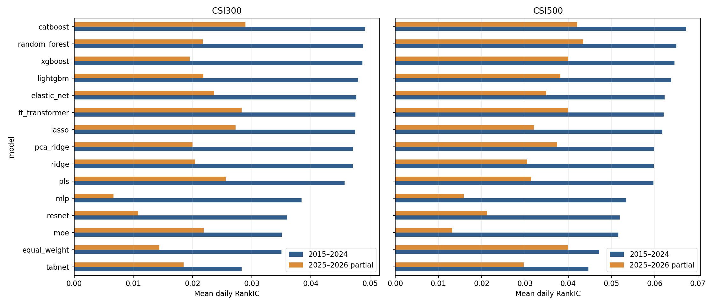

# CSI300 & CSI500 Price–Volume Factor Research

Research on dynamic CSI300 and CSI500 constituents: price–volume factor construction, single-factor backtests, 15-model signal combination, and new-period out-of-sample prediction evaluation.

**857 candidate factor fields · 1706 factor–universe backtests · 15 models · 2 universes.** Window variants are not independent signals. This is auditable historical research, not a promise of live returns.

## Representative single-factor IC and RankIC

Five examples cover momentum (`PV_MOM_20`), volatility (`PV_VOL_20`), turnover variability (`PV_TURN_STD_30`), illiquidity (`PV_AMIHUD_20`), and a report-formula implementation (`HT101_001`). They illustrate different formula families and were **not selected as the highest-IC factors**.

**Window: 2015-01-05–2024-12-27.** Values are arithmetic means of daily cross-sectional Pearson IC and Spearman RankIC against one-session forward VWAP returns, after library preprocessing (MAD, industry/size neutralization, standardization). The **original factor sign is retained**, including negative correlations; no full-period sign flip is applied. Each row has 2429 valid days except CSI500 `HT101_001` (2428).

| Factor | CSI300 IC | CSI300 RankIC | CSI500 IC | CSI500 RankIC |
|---|---:|---:|---:|---:|
| PV_MOM_20 | -0.01032 | -0.02009 | -0.01372 | -0.02730 |
| PV_VOL_20 | -0.00418 | -0.02277 | -0.00935 | -0.03364 |
| PV_TURN_STD_30 | -0.01155 | -0.01933 | -0.01706 | -0.03354 |
| PV_AMIHUD_20 | 0.00329 | 0.00683 | 0.00330 | 0.01100 |
| HT101_001 | -0.00947 | -0.01814 | -0.00981 | -0.01940 |

[Summary and coverage](backtests/results/representative_single_factor_ic.csv) · [Daily aggregate IC/RankIC](backtests/results/representative_single_factor_daily_ic.csv) · [Formulas](factors/catalog.json)

A negative IC means higher factor values were associated with lower subsequent returns. It does not establish that reversing the factor will generate profitable trades after costs.

## Model-composite IC and RankIC

Every quarter, select **exactly 100 factors using prior realized data**, determine their signs from the training window, tune on historical inner validation, and refit each model. Models learn a cross-sectional return-ranking target; reported IC/RankIC compares their daily scores with **raw forward returns**, not the rank target. IC = Pearson; RankIC = Spearman; both are averaged across valid daily cross-sections (minimum 30 stocks). Scores are not predicted return percentages.

### Historical rolling out-of-sample: 2015–2024

Evaluation dates: **2015-01-05–2024-12-27 (2429 sessions)**. This historical window has already been viewed during research; it is not an untouched final holdout. Rows follow CSI300 historical RankIC ordering.

| Model | CSI300 IC | CSI300 RankIC | CSI500 IC | CSI500 RankIC |
|---|---:|---:|---:|---:|
| catboost | 0.03785 | 0.04916 | 0.04875 | 0.06728 |
| elastic_net | 0.03715 | 0.04881 | 0.04336 | 0.06228 |
| equal_weight | 0.02627 | 0.03506 | 0.02896 | 0.04715 |
| ft_transformer | 0.03541 | 0.04749 | 0.04376 | 0.06208 |
| lasso | 0.03652 | 0.04871 | 0.04189 | 0.06175 |
| lightgbm | 0.03579 | 0.04568 | 0.04597 | 0.06381 |
| mlp | 0.03043 | 0.03601 | 0.04429 | 0.05339 |
| moe | 0.03181 | 0.03843 | 0.04399 | 0.05159 |
| pca_ridge | 0.03583 | 0.04797 | 0.04065 | 0.05987 |
| pls | 0.03545 | 0.04708 | 0.04273 | 0.05970 |
| random_forest | 0.03630 | 0.04754 | 0.04434 | 0.06505 |
| resnet | 0.02925 | 0.03504 | 0.04194 | 0.05189 |
| ridge | 0.03656 | 0.04711 | 0.04291 | 0.05978 |
| tabnet | 0.01982 | 0.02827 | 0.02512 | 0.04463 |
| xgboost | 0.03767 | 0.04766 | 0.04669 | 0.06457 |

### New-period evaluation: 2025–2026

Evaluation dates: **2025-01-02–2026-10-15 (430 sessions)**. The same protocol updates models quarterly using only prior data; models are not permanently frozen at the end of 2024. Predictions continue through 2026-10-19, but final labels are incomplete. Rows follow CSI300 new-period RankIC ordering.

| Model | CSI300 IC | CSI300 RankIC | CSI500 IC | CSI500 RankIC |
|---|---:|---:|---:|---:|
| catboost | -0.00387 | 0.02892 | 0.00355 | 0.04207 |
| elastic_net | -0.00886 | 0.02171 | -0.00160 | 0.03496 |
| equal_weight | -0.01083 | 0.02190 | 0.00166 | 0.03992 |
| ft_transformer | 0.00039 | 0.02729 | 0.00557 | 0.03996 |
| lasso | -0.01048 | 0.01950 | -0.00469 | 0.03207 |
| lightgbm | -0.00482 | 0.02562 | 0.00325 | 0.03818 |
| mlp | -0.00036 | 0.01078 | -0.00159 | 0.01583 |
| moe | -0.00804 | 0.00662 | -0.00293 | 0.01320 |
| pca_ridge | -0.00552 | 0.02184 | 0.00372 | 0.03747 |
| pls | -0.00578 | 0.02041 | 0.00387 | 0.03141 |
| random_forest | -0.00423 | 0.02827 | 0.00611 | 0.04352 |
| resnet | -0.00579 | 0.01442 | -0.00172 | 0.02126 |
| ridge | -0.00553 | 0.02000 | 0.00318 | 0.03049 |
| tabnet | 0.00009 | 0.01848 | 0.00324 | 0.02972 |
| xgboost | -0.00574 | 0.02365 | 0.00630 | 0.03996 |

CatBoost leads historical mean IC and RankIC in both universes. New-period performance is weaker: CSI300 CatBoost has negative mean Pearson IC despite positive RankIC; Random Forest leads CSI500 RankIC. Both metrics and the deterioration are retained. The representative single factors are not the strongest-single-factor benchmark, and their original signs differ from training-oriented model inputs. These tables alone do **not** establish statistically significant superiority over all single factors or profitable trading.

[Historical metrics](research/results/historical_comparison.csv) · [New-period metrics](research/results/new_period_comparison.csv) · [Full model research, including native rank R²](research/README.md)



## Research pipeline


## Navigation

| Content | Location |
|---|---|
| Data sources, private input formats and limitations | [Data](docs/DATA.md) |
| Factor, backtest and model methodology | [Methodology](docs/METHODOLOGY.md) |
| Formula and field catalogs | [Factor catalog](factors/catalog.json), [report formulas](factors/report_formulas.json) |
| Single-factor periods and rebalancing frequencies | [Backtests](backtests/README.md) |
| Historical and new-period 15-model results | [Research](research/README.md) |
| Interactive results notebook | [Results explorer](notebooks/results_explorer.ipynb) |

## Installation and usage

Aggregate CSVs can be viewed without private data. Running the research requires Python 3.13 and independently licensed data. Pinned dependencies record the local environment; matching binary packages may not exist on every platform.

```bash
python -m pip install -r requirements.txt
python -m unittest discover -s tests -v
```

`PRIVATE_ROOT` is a local directory following the documented schema, not data bundled with this repository. Generated datasets, model weights and stock-level predictions stay in local output directories.

```bash
# Export corrected standardized inputs from the original local project, if available
python scripts/prepare_local_inputs.py --source ORIGINAL_PROJECT --out PRIVATE_ROOT

# Alternatively, build factors from your own standardized prices and industry records
python scripts/build_factors.py --root PRIVATE_ROOT --universe csi300 --industry INDUSTRY.parquet --start-year 2010 --end-year 2026

# Single-factor results with 1/5/20-session rebalancing
python scripts/run_single_factor.py --root PRIVATE_ROOT --universe csi300 --factor PV_MOM_20 --out outputs/single_factor

# Pilot one historical quarter; remove --pilot for the full interval
python scripts/train_models.py --root PRIVATE_ROOT --universe csi300 --start 2015Q1 --end 2024Q4 --out outputs/csi300_history --pilot

# New period with quarterly retraining; use --universe csi500 for the second universe
python scripts/train_models.py --root PRIVATE_ROOT --universe csi300 --start 2025Q1 --end 2026Q4 --out outputs/csi300_new_period
```

The 15 models are Equal Weight, Ridge, Lasso, Elastic Net, PCA + Ridge, PLS, Random Forest, XGBoost, LightGBM, CatBoost, MLP, ResNet, TabNet, FT-Transformer and Mixture of Experts (MoE).

## Versions and reproducibility

Historical 2015–2024 results use corrected report factors. The 2025–2026 extension uses the same corrected engine with historical continuity checks.

For single-factor results, 154 changed factor–universe inputs were rerun, two unchanged controls were rerun, and 1550 unchanged outputs were reused. See [result lineage](backtests/result_lineage.json). Complete input hashes were unavailable for the old batch; we do not claim that all 1706 results were newly computed.

The public refactor preserves core formulas, preprocessing, model architectures, hyperparameters and evaluation definitions, with synthetic-data tests. Private source data is not distributed, so cloning this repository alone cannot reproduce every historical number. Vendor revisions, hardware and floating-point paths can also affect results. Validate a small sample first.

## Release scope and license

Included: formulas, implementations, input documentation and aggregate results. Excluded: vendor spreadsheets, raw prices, stock-level factors/predictions, model weights, brokerage PDFs and unrelated experiments. The `research` folder evaluates prediction only; it contains neither model portfolio-return backtests nor historical score-to-return calibration results.

Original code is licensed under [MIT](LICENSE). Qlib attribution and notices are retained in [THIRD_PARTY.md](THIRD_PARTY.md). This license does not grant redistribution rights to vendor datasets, source reports or external dependencies.
