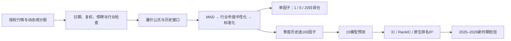

# CSI300 & CSI500 Price–Volume Factor Research

沪深300与中证500动态成分股：从量价因子构建、单因子回测，到15模型合成信号及新时期样本外预测检验。

**857个候选因子字段、1706份单因子结果、15种模型、两个股票池。** 多窗口版本不代表独立信号；本项目是可审计的历史研究，不是实盘收益承诺。



## 从哪里开始

| 内容 | 位置 |
|---|---|
| 数据来源、私有数据格式与边界 | [docs/DATA.md](docs/DATA.md) |
| 因子、回测与模型方法 | [docs/METHODOLOGY.md](docs/METHODOLOGY.md) |
| 公式与字段目录 | [factors/catalog.json](factors/catalog.json)、[研报公式](factors/report_formulas.json) |
| 单因子各时期与调仓频率结果 | [backtests](backtests/README.md) |
| 15模型历史与新增时期结果 | [research](research/README.md) |
| 结果浏览笔记本 | [notebooks/results_explorer.ipynb](notebooks/results_explorer.ipynb) |

## 安装与运行

结果CSV无需私有数据即可浏览。运行研究代码需Python 3.13及自行取得授权的数据；锁定依赖记录的是本次本地环境，不保证所有平台都有相同二进制包。

```bash
python -m pip install -r requirements.txt
python -m unittest discover -s tests -v
```

下列`PRIVATE_ROOT`是符合数据格式说明的本地目录，不是GitHub仓库自带的数据。所有生成的数据、训练权重及逐股票预测只写入本地输出。

```bash
# 有原始本地研究项目时，导出修正后的标准化输入（不上传）
python scripts/prepare_local_inputs.py --source ORIGINAL_PROJECT --out PRIVATE_ROOT

# 或者使用自行整理的行情和行业记录，重新构建因子
python scripts/build_factors.py --root PRIVATE_ROOT --universe csi300 --industry INDUSTRY.parquet --start-year 2010 --end-year 2026

# 单因子：保留1、5、20日调仓的历史对照
python scripts/run_single_factor.py --root PRIVATE_ROOT --universe csi300 --factor PV_MOM_20 --out outputs/single_factor

# 历史15模型：先用--pilot检查一个季度，去掉后运行完整区间
python scripts/train_models.py --root PRIVATE_ROOT --universe csi300 --start 2015Q1 --end 2024Q4 --out outputs/csi300_history --pilot

# 新时期，按历史规则每季度重新训练；改universe即可跑中证500
python scripts/train_models.py --root PRIVATE_ROOT --universe csi300 --start 2025Q1 --end 2026Q4 --out outputs/csi300_new_period
```

15模型包括等权、Ridge、Lasso、Elastic Net、PCA＋Ridge、PLS、随机森林、XGBoost、LightGBM、CatBoost、MLP、ResNet、TabNet、FT-Transformer和MoE。模型学习未来收益排名，不能把输出分数解释成直接预测的收益百分比。

## 已有结果与版本说明

2015—2024历史比较采用修正后的研报因子；2025—2026采用同一修正引擎，并核对历史衔接。历史期已被研究者查看，不能称作从未见过的最终测试集。

单因子汇总中154份输入变化的结果已重跑、2份未变化的控制试跑、1550份未变化结果复用，见[结果来源记录](backtests/result_lineage.json)。旧批次缺少完整输入哈希，因此不声称1706份都在本次重新计算。

公开重构保留核心公式、优化前处理、模型结构、超参数与评价定义，并提供合成数据测试。本地源数据不公开，无法仅克隆仓库就逐数字复现历史结果；原始供应商修订、硬件及浮点路径也可能影响结果。请先跑小样本验证。

## 开源范围

发布公式、实现、数据接口说明和聚合结果。不发布供应商Excel、原始行情、逐股票因子值、逐股票预测、模型权重、券商PDF和无关研究。`research`只研究预测能力，不含模型投资组合收益或分数到收益的历史校准结果。

原始代码采用[MIT](LICENSE)，Qlib相关出处与许可保留在[THIRD_PARTY.md](THIRD_PARTY.md)。数据、来源报告和外部依赖不因本仓库的MIT许可而获得再分发授权。
